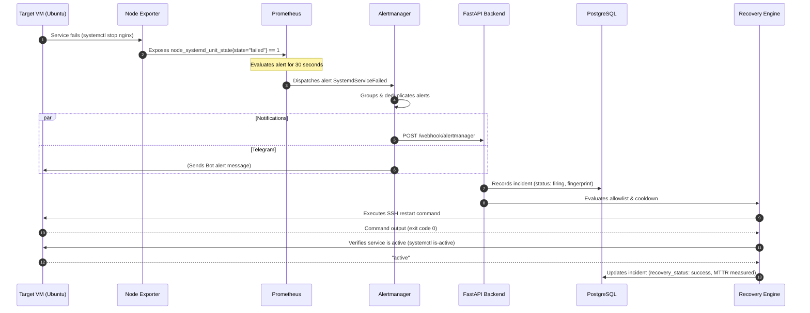

# Cloud Infrastructure Monitoring and Automated Alerting System — Architecture

## 1. System Overview

The **Cloud Infrastructure Monitoring and Automated Alerting System** provides end-to-end telemetry collection, real-time metrics analysis, multi-channel alerting, persistent incident lifecycle tracking, and automated remediation for Linux infrastructure (Ubuntu VMs on VirtualBox / bare-metal / containers).

```
+-----------------------------------------------------------------------------------+
|                            TARGET INFRASTRUCTURE (Ubuntu VMs)                    |
|                                                                                   |
|  [ app-server-1: 192.168.56.11 ]                 [ app-server-2: 192.168.56.12 ]  |
|  - CPU, RAM, Disk, Net, Systemd                  - CPU, RAM, Disk, Net, Systemd   |
|  - Node Exporter (port 9100)                     - Node Exporter (port 9100)      |
+-----------------------------------------------------------------------------------+
                                         |
                       Metrics Scrape (HTTP /metrics every 15s)
                                         v
+-----------------------------------------------------------------------------------+
|                        CENTRAL MONITORING & OBSERVABILITY ENGINE                  |
|                                                                                   |
|   +------------------------------------+    +---------------------------------+   |
|   |          Prometheus Engine         |    |       Grafana Dashboards        |   |
|   | - 15s Scrape / Evaluation Interval |    | - Infrastructure Overview       |   |
|   | - PromQL Alert Rules Engine        |--->| - CPU & Memory Deep-Dive        |   |
|   | - TSDB Time Series Storage         |    | - Disk & Network Analytics      |   |
|   +------------------------------------+    | - Service Health & Systemd      |   |
|                     |                       | - Incident Operations           |   |
|                     | Alert Firing / Resolve+---------------------------------+   |
|                     v                                                             |
|   +------------------------------------+                                          |
|   |            Alertmanager            |                                          |
|   | - Deduplication & Grouping         |                                          |
|   | - Routing & Inhibition             |                                          |
|   +------------------------------------+                                          |
|            |                      |                      |                        |
+------------|----------------------|----------------------|------------------------+
             |                      |                      |
             v                      v                      v
     +---------------+      +---------------+      +--------------------------------+
     | Telegram Bot  |      |   SMTP Email  |      |     FastAPI Webhook Backend    |
     | Instant Alert |      |  HTML Alerts  |      | - Payload Validation           |
     | Notifications |      | Notifications |      | - Incident State Management    |
     +---------------+      +---------------+      +--------------------------------+
                                                                   |
                                          +------------------------+------------------------+
                                          |                                                 |
                                          v                                                 v
                               +---------------------+                           +--------------------+
                               | PostgreSQL Database |                           | Automated Recovery |
                               | - Incidents History |                           | Engine             |
                               | - Recovery Audit    |                           | - Service Restart  |
                               | - Metrics & Timing  |                           | - Bounded Cleanups |
                               +---------------------+                           | - SSH Remediation  |
                                                                                 +--------------------+
                                                                                            |
                                                                                Remediate via SSH (port 22)
                                                                                            v
                                                                               [ Monitored Target VMs ]
```

---

## 2. Component Breakdown and Responsibilities

| Component | Technology | Listening Port | Responsibility |
|---|---|---|---|
| **Node Exporter** | Prometheus Node Exporter v1.8.2 | `9100` | Scrapes hardware and OS metrics (CPU, memory, disk, network, systemd units). Exposes `/metrics`. |
| **Prometheus** | Prometheus v2.54.1 | `9090` | Central time-series database. Scrapes targets every 15s, evaluates PromQL alert expressions, sends alerts to Alertmanager. |
| **Alertmanager** | Prometheus Alertmanager v0.27.0 | `9093` | Receives alerts from Prometheus. Deduplicates alerts, groups identical notifications, routes alerts to Telegram, Email, and FastAPI backend. |
| **Grafana** | Grafana v11.4.0 | `3000` | Real-time visualization platform. 5 pre-provisioned dashboards covering overview, CPU/RAM, disk/net, services, and incidents. |
| **FastAPI Backend** | Python 3.11 + FastAPI + SQLAlchemy | `8000` | Ingests webhooks from Alertmanager, validates payloads, manages incident lifecycle, triggers automated remediation playbooks. |
| **PostgreSQL** | PostgreSQL 16 | `5432` | Relational storage for incidents, alert history, recovery timestamps, stdout/stderr audit logs, and performance metrics. |
| **Recovery Engine** | Python + Asyncio + Paramiko SSH | Internal | Safely executes predefined, allowlisted playbooks on target VMs with strict validation, cooldown, and verification. |

---

## 3. Network Architecture & VM Topology

### Host-Only Network (VirtualBox)
- **Subnet CIDR:** `192.168.56.0/24`
- **Gateway / Host Adapter:** `192.168.56.1`
- **Monitoring Server VM:** `192.168.56.10`
- **Target App VM 1:** `192.168.56.11`
- **Target App VM 2:** `192.168.56.12`

### Communication Matrix
1. **Target VMs $\to$ Monitoring Server:** Ingress allowed on port 22 (SSH remediation from backend).
2. **Monitoring Server $\to$ Target VMs:** Ingress allowed on port 9100 (Prometheus scrape).
3. **Alertmanager $\to$ External APIs:** Egress on port 443 (Telegram API `api.telegram.org`), port 587 (SMTP TLS).
4. **Alertmanager $\to$ Backend:** Internal HTTP POST on `http://backend:8000/webhook/alertmanager`.
5. **Backend $\to$ PostgreSQL:** Internal TCP on `postgres:5432`.

---

## 4. Remediation Workflow Sequence


